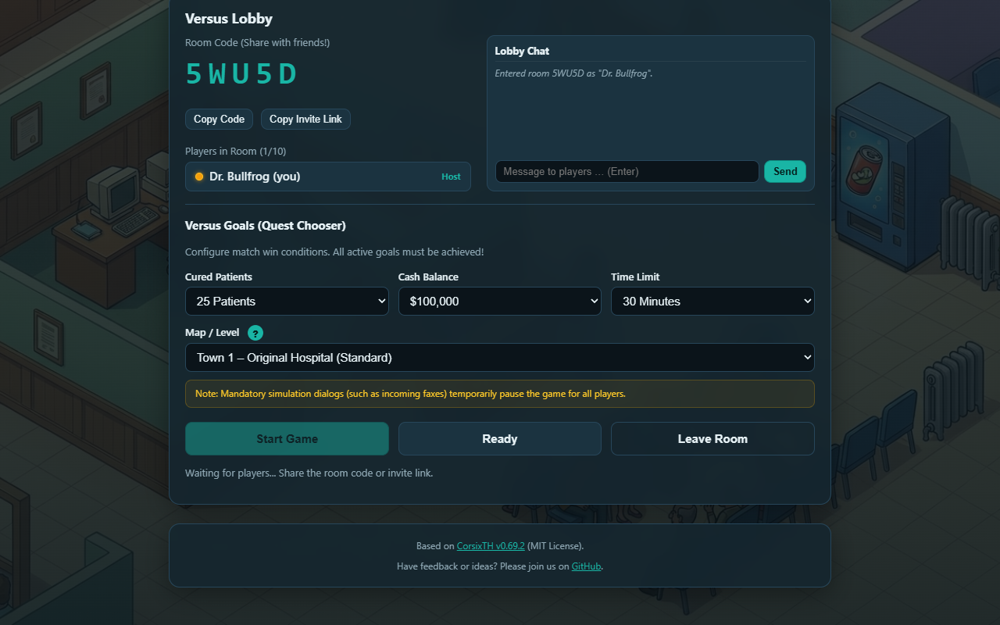

# Browser Theme Hospital – Versus

A web-based port of the open-source CorsixTH engine (compiled to WebAssembly) designed for real-time multiplayer versus matches directly in the web browser.

## Live Demo

Play the live demo directly in your browser:  
https://bthvs.vercel.app

## About the Project

Browser Theme Hospital Versus allows players to compete head-to-head on the same hospital map in real time. Rather than running a traditional singleplayer hospital, players face off to reach customizable win conditions or hold the highest hospital value and cash balance before time expires.

The multiplayer networking operates serverless via WebRTC P2P DataChannels directly between browser sessions, with an optional WebSocket relay fallback for restrictive networks. No local server installation or browser plugins are required.

## What It Does

- Real-Time Versus Competition: Create open or private rooms for up to 10 players.
- Customizable Win Conditions: Configure match goals combining cured patients, cash balance targets, and countdown timers.
- Direct Lobby Invite Links: Share instant join links that automatically configure goal settings and connect guests directly into the lobby.
- In-Game HUD and Rival Dashboard: Monitor live statistics, hospital reputation, patient cure rates, and rival metrics side-by-side.
- In-Game Chat and Quests: Resizable and draggable in-game windows that automatically persist size and position across sessions.
- Map Selector with Visual Previews: Explore original level layouts and plots via an integrated preview modal before launching.

## Game Data and Legal Notice

This repository contains only open-source code and does not distribute any copyrighted Theme Hospital assets, audio, graphics, or level files (Bullfrog / Electronic Arts).

Players load their own original game data files (Theme Hospital demo or full version from GOG or EA) directly in the browser via ZIP archive or folder selection. All game assets are stored locally in the browser's IndexedDB and never uploaded to any external server.

CorsixTH is licensed under the MIT License. Theme Hospital is a trademark of Electronic Arts.
